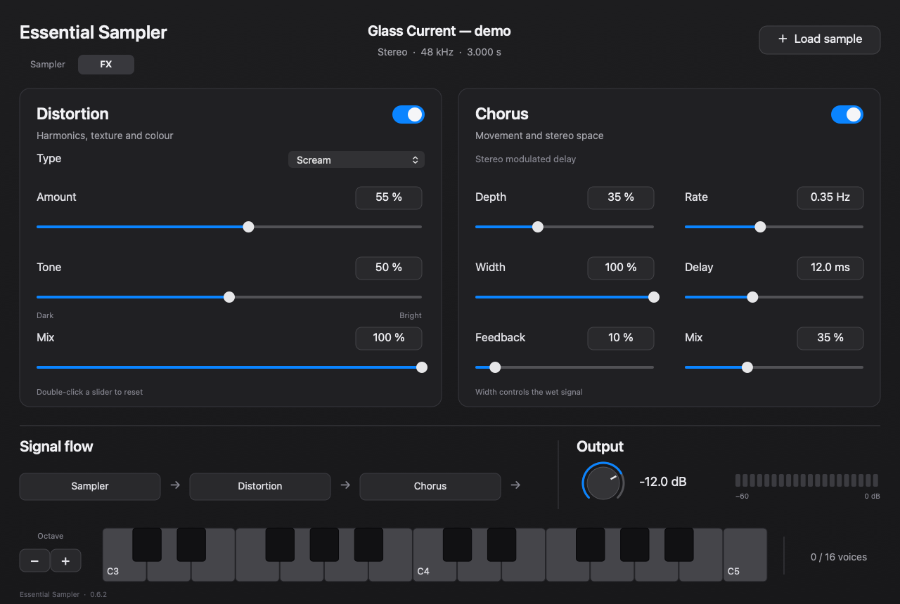

# Essential Sampler

A native macOS sampler with independent pitch and time controls, hands-on loop editing, distortion and chorus. Available as **VST3**, **Audio Unit (AUv2)** and a standalone app.

The instrument appears in your DAW as **hasio → Essential Sampler**. Previously released as Hasio Loop; internal plugin and parameter identifiers are unchanged so hosts can recognize existing sessions after rescanning.


[Download v0.6.2](https://github.com/h4s10/EssentialSampler/releases/tag/v0.6.2) · [User guide](docs/USAGE.md) · [Build and test](docs/DEVELOPMENT.md) · [Changelog](CHANGELOG.md)

## Requirements and release status

- **Apple Silicon (arm64), macOS 27 or newer.** Intel, Windows and older macOS builds are not included.
- A VST3 host, or Logic Pro / another AUv2 instrument host. The standalone app does not require a DAW.
- Releases currently use **ad-hoc signatures** and are not Developer ID signed or notarized.

**This is a prerelease.** DSP, VST3 host, native UI and direct AU interface tests pass. The build environment cannot access the system AudioComponent registry, so Apple `auval` and actual Logic integration have not yet been confirmed. See [verification details](docs/VERIFICATION.md).

## Install

1. Download and unzip **AU**, **VST3** or **all** from [Releases](https://github.com/h4s10/EssentialSampler/releases).
2. Close your DAW and run `Install.command`. Existing plugin versions are backed up beside the installed bundle.
3. Reopen your DAW. In Logic, create a Software Instrument track and select **AU Instruments → hasio → Essential Sampler → Stereo**. In Ableton Live, enable system VST3 folders and rescan plugins.

| Download | Contents | Install location |
| --- | --- | --- |
| `…-AU.zip` | Audio Unit instrument | `~/Library/Audio/Plug-Ins/Components/Essential Sampler.component` |
| `…-VST3.zip` | VST3 instrument | `~/Library/Audio/Plug-Ins/VST3/Essential Sampler.vst3` |
| `…-all.zip` | Both plugins and the standalone app | Plugins as above; open the included `.app` directly |
| `…-source.zip` | Source and bundled build dependencies | Build locally using the instructions below |

The installer verifies each bundle's signature and identity, removes download quarantine **only from that verified Essential Sampler bundle**, and checks AU registration before running native arm64 `auval`. It does not disable Gatekeeper, delete shared plugin caches or stop your DAW.

### AU installed, but not found

Version 0.6.0 could immediately run validation before macOS discovered the new component. A message such as `FATAL ERROR: didn't find the component` means discovery failed; audio/DSP validation has not started.

Use the **0.6.2 installer**, or run `Repair-AU.command` from its archive to repair the existing installation without replacing the plugin. The repair verifies the installed bundle, handles its quarantine flag, and refreshes the current user's Audio Unit registrar if the component is missing. It then waits briefly for registration and runs:

```sh
arch -arm64 auval -v aumu HsLp Hasi
```

If it remains unregistered, restart your Mac once and try again. Apple also documents this step for newly installed Audio Units: [Plugin discovery troubleshooting](https://support.apple.com/en-gb/122179).

If the component **is listed** but validation fails, keep the validation log printed by the installer and [open an issue](https://github.com/h4s10/EssentialSampler/issues). Repeated cache resets do not resolve a plugin API or rendering failure. If Logic lists the plugin as failed, use **Settings → Plug-in Manager → Reset & Rescan Selection** after resolving the reported error.

## Updating from Hasio Loop

Use `Install.command` from the new release with your DAW closed. It installs **Essential Sampler.vst3** / **Essential Sampler.component** and backs up the old Hasio Loop bundles outside their scanned file extensions. This prevents duplicate plugins with the same internal identity. Reopen or rescan your DAW to refresh the displayed name.

Existing project folders do not need to be renamed. No audio settings or sample-state format have changed.

## Features

- Load mono/stereo **WAV, AIFF and FLAC** with a file picker or drag and drop.
- Full-sample overview plus a detailed waveform, movable loop range and editable Start / End / Length fields.
- Trackpad pinch zoom, vertical scroll zoom and horizontal panning.
- **One-shot, Forward, Reverse, Ping-pong and Reverse shot** playback modes.
- **Tune ±24 semitones** without changing playback speed. Keep duration also separates MIDI pitch from playback duration.
- Independent **0.25×–4× Speed**, or host-synced lengths from **4 bars to 1/32**.
- Loop Fade In / Fade Out, Attack / Release and a dedicated Output knob.
- **16 voices**, 26 automatable controls and sample-accurate MIDI/automation offsets.
- Samples embedded in saved DAW state, so the original audio file is not required when reopening the project.
- Separate **FX** tab with six distortion types and a stereo chorus. Both effects default to off.



See the [user guide](docs/USAGE.md) for gestures, timing behavior, effects and compatibility details.

## Current limits

One sample layer and one loop region; fixed 1280 × 860 editor. No spectral selection, spectrogram, filter section, automatic BPM detection, launch quantization, sustain pedal, MPE, pitch bend, preset browser or standalone session saving.

Pitch/time processing reports a fixed **2048-sample latency** (42.7 ms at 48 kHz). Extreme stretching or compression can soften transients or merge nearby events; formants are not preserved. Polyphonic output can exceed 0 dBFS, so adjust Output. Maximum decoded sample size is **192 MiB**, at **8–384 kHz**, mono or stereo. Embedded PCM increases DAW project size.

## Build from source

Install Apple Command Line Tools and Python 3 on an Apple Silicon Mac running macOS 27+. The build uses C++17, Objective-C++, Cocoa, AudioToolbox and Accelerate. No JUCE, CMake, full Xcode installation or network download is required.

```sh
git clone https://github.com/h4s10/EssentialSampler.git
cd EssentialSampler
bash scripts/build.sh
bash scripts/test.sh
bash scripts/package.sh
```

Bundles are written to `releases/0.6.2/`; zip archives are written to `releases/`. See [development documentation](docs/DEVELOPMENT.md) for architecture, validation and installation commands.

## License and credits

Project code is licensed under **[MIT](LICENSE)**. You may use, modify and distribute it, including commercially, while retaining the copyright and license notice.

VST3 interface headers and Xiph FLAC/Ogg dependencies retain their own notices; see [THIRD_PARTY_NOTICES.md](THIRD_PARTY_NOTICES.md). Source, artwork and the oscillator-generated demo sample are part of this project. No iZotope binaries, source code, artwork, presets or samples are distributed. This is an independent sampler, not an Iris DSP port or an affiliated iZotope product.
